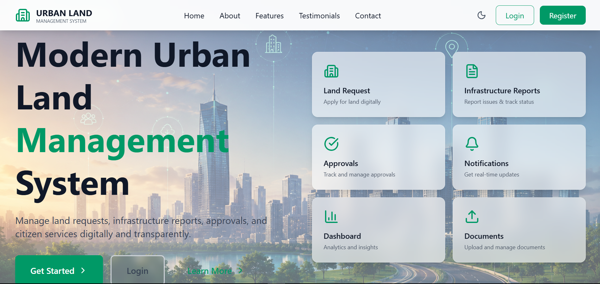
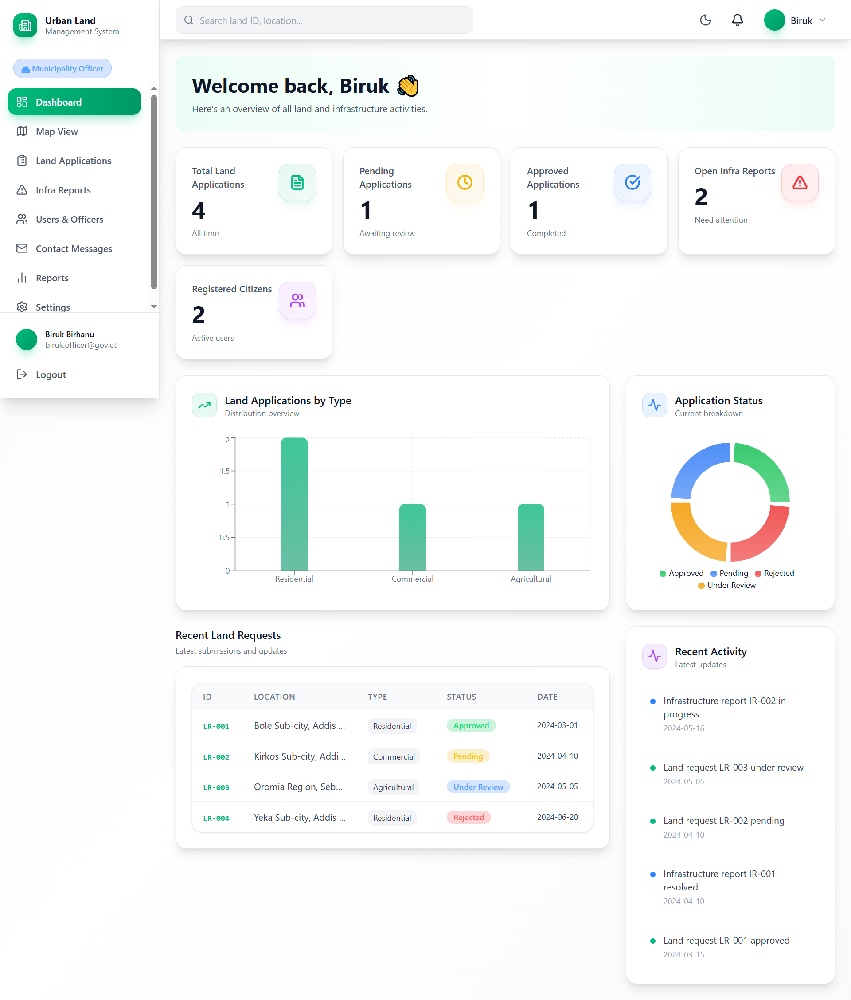

# 🏙️ ULMIS — Urban Land Management Information System

A full-stack web application designed to support urban land administration, citizen services, infrastructure reporting, and administrative workflows.

**Repository:** [birukb1152-dot/ULMIS](https://github.com/birukb1152-dot/ULMIS)

## 🖼️ Screenshots

### Application Overview



_ULMIS application overview._

Additional screenshots can be added as the project develops, including the landing page, authentication pages, citizen dashboard, land requests, infrastructure reports, and officer dashboard.

## 📌 Overview

ULMIS aims to make urban land and infrastructure-related services easier to access and manage through a centralized web application. The project includes a React frontend and a Node.js/Express backend connected to MongoDB.

## ✨ Features

- **Authentication and user roles** — citizen and officer roles.
- **Land requests** — interfaces and backend modules for land-related requests.
- **Infrastructure reporting** — modules for infrastructure reports.
- **Dashboard** — a centralized overview of application information.
- **Notifications** — notification-related functionality.
- **Contact messages** — contact-message management modules.
- **User management** — interfaces and backend functionality for users.
- **Responsive interface** — reusable UI components and layout.
- **Documentation** — setup guides, API documentation, and project notes.

_Feature availability and completeness should be verified in a running environment._

## 🧰 Technology Stack

| Area           | Technologies                    |
| -------------- | ------------------------------- |
| Frontend       | React, Vite, JavaScript, CSS    |
| Backend        | Node.js, Express                |
| Database       | MongoDB, Mongoose               |
| Authentication | JSON Web Tokens (JWT), bcryptjs |
| HTTP requests  | Axios                           |
| Development    | Git, npm                        |

## 📂 Project Structure

```text
ULMIS/
├── backend/
│   ├── src/
│   │   ├── config/
│   │   ├── controllers/
│   │   ├── middleware/
│   │   ├── models/
│   │   ├── routes/
│   │   └── server.js
│   ├── .env.example
│   ├── package.json
│   └── package-lock.json
├── frontend/
│   ├── public/
│   ├── src/
│   │   ├── api/
│   │   ├── components/
│   │   ├── context/
│   │   └── pages/
│   ├── documentation/
│   ├── package.json
│   └── vite.config.js
├── .gitignore
└── README.md
```

## ⚙️ Prerequisites

Install the following before running the project:

- [Node.js](https://nodejs.org/) — use a version compatible with the project's dependencies.
- npm, included with Node.js.
- [MongoDB Community Server](https://www.mongodb.com/try/download/community), or an accessible MongoDB deployment.
- [Git](https://git-scm.com/).

## 🚀 Getting Started

### 1. Clone the repository

```bash
git clone https://github.com/birukb1152-dot/ULMIS.git
cd ULMIS
```

### 2. Configure the backend

```bash
cd backend
npm install
```

Create a local `.env` file in the `backend/` directory, using `.env.example` as a reference.

Example development configuration:

```env
PORT=5000
MONGO_URI=mongodb://localhost:27017/urban_land_db
JWT_SECRET=replace_with_a_long_random_secret
JWT_EXPIRES_IN=7d
NODE_ENV=development
```

Replace the JWT secret with a strong, randomly generated value. Never commit your actual `.env` file or production secrets.

Make sure MongoDB is running and the connection string matches your environment.

### 3. Start the backend

From the `backend/` directory, run:

```bash
npm run dev
```

If the development script is unavailable, inspect `backend/package.json` for the correct script.

### 4. Configure and start the frontend

Open a second terminal from the project root:

```bash
cd frontend
npm install
npm run dev
```

Open the local URL printed by Vite in the terminal.

If the frontend cannot reach the backend, check `frontend/src/api/axios.js`, the backend port, and the CORS configuration. Use the API base URL expected by your current application.

## 🔐 Security Notes

- Keep `.env` files and credentials out of version control.
- Use strong, unique secrets outside development.
- Validate incoming requests on the backend.
- Apply authentication and authorization checks to protected routes.
- Avoid returning password hashes or other sensitive fields in API responses.
- Use HTTPS and secure deployment configuration in production.
- Review database deletion and seed scripts carefully before running them.

## 📚 Documentation

Project documentation is available in [`frontend/documentation/`](frontend/documentation/).

Useful starting points:

- [API Documentation](frontend/documentation/API_DOCUMENTATION.md)
- [Installation Guide](frontend/documentation/INSTALLATION.md)
- [Deployment Guide](frontend/documentation/DEPLOYMENT.md)
- [Security Documentation](frontend/documentation/SECURITY.md)
- [Project Overview](frontend/documentation/PROJECT_OVERVIEW.md)

Confirm that each guide matches the current implementation before following it.

## 🖼️ Screenshots

Screenshots of the application can be added here to demonstrate the real interface.

Suggested screenshots:

- Landing page
- Login and registration
- Main dashboard
- Citizen land-request page
- Infrastructure-report page
- Officer dashboard and message management

Store screenshots in a folder such as `docs/screenshots/` and reference the actual filenames here once they exist.

## 🛣️ Future Improvements

Potential next steps include:

- Automated frontend and backend tests.
- API validation and error-handling improvements.
- Role-based access-control review.
- Deployment and environment configuration.
- Continuous integration with GitHub Actions.
- Improved accessibility and mobile usability.
- Additional technical documentation.

These are suggested improvements, not claims that the features are already implemented.

## 🤝 Contributing

1. Fork the repository.
2. Create a feature branch.
3. Make and test your changes.
4. Commit your work with a descriptive message.
5. Open a pull request describing your changes.

## 👨‍💻 Author

**Biruk** — Full-stack developer in training.

- GitHub: [@birukb1152-dot](https://github.com/birukb1152-dot)
- Project: [ULIMIS](https://github.com/birukb1152-dot/ULMIS)

## 📄 License

No root-level license has been specified yet. Add a license only after choosing the terms under which you want others to use and distribute this project.
